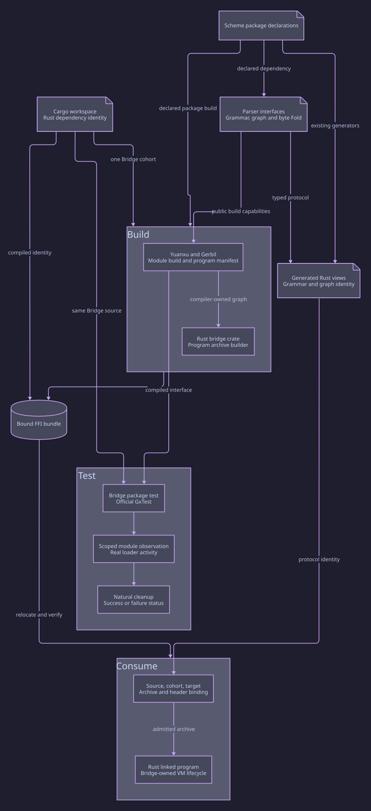

#+title: 20.09 Yuanxu Module Build Ownership
#+date: 2026-10-28

* CI dependency coherence

The native package, Cargo dependencies and both Cargo lockfiles must name the
same declared Parser revision. Updating a dependency declaration without the
fuzz lock cannot pass preparation; the revision check remains required.
Cargo exclusively owns gerbil-scheme-rust and its immutable source revision.
Scheme imports of its program producer and rooted-bytevector runtime do not
create a Gerbil package dependency. The existing ci-prepare entry checks the
Cargo-selected checkout and builds its Scheme modules into the shared output
before building Orgize. The dependency gate rejects a bridge edge in gerbil.pkg;
Cargo declarations and lockfiles retain their existing exact-revision checks.
Agentic AI Lab, Parser and Orgize do not repeat this Cargo dependency in Gerbil.
Default package compilation uses Just's executing-host CPU count; explicit
paired benchmark controls retain their own declared parameters. Dependency
alignment is a preparation check, not runtime or performance acceptance.

* Superseded ownership guidance

The API/root inventories and test executable described below are superseded by
[[file:20.10_module_cli_and_mop_reuse_audit.org][20.10 Native CLI and MOP Reuse Audit]]. This record retains earlier evidence.

* Candidate and dependency identity

Uncommitted Orgize candidate on =codex/org-object-aot-completion=, based on
=e3cf4acc9f5e355dba94b4017167885e47ae50c9=. Pre-existing local work, including
the native tape producer/consumer, is retained. This record is implementation
and local qualification evidence, not a release or remote CI receipt.

Parser's published development branch was inspected at
=811e18e4b72a2cc049755fa39567a6a6bc671f4c=. The native =gerbil.pkg= already
selected that revision; Cargo and fuzz still selected =461fa6f5= and now agree
with the native owner. Cargo performed both lockfile updates. Parser selects
Yuanxu =643366eb0162e6ca821f391a32dc268bf89db5d7=, whose POO dependency is
=c0d47633c2aad7591944f874eaf730ee9c0e451e=. Orgize does not repeat those pins.
The separate, dirty Parser development checkout was not modified.

* Ownership and entrypoints

[[file:../../init.ss][Root init]] selects the Org Parser, Element and Contract Modules and the
independent native C capability using =yuanxu!=. Each =interface.ss= is a
Module declaration. The Parser prelude supplies the language/declaration entry;
runtime operations remain in their owning Module capability interfaces.
The redundant Parser =src/api.ss= umbrella and old =interface.ss= API
forwarding shims are not installed.

[[file:../../build.ss][Package build]] delegates the library projection to Yuanxu's
=std-make-spec= and =building/script= adapter. Module Build contributions name
public roots and actual foreign compiler options. Yuanxu derives their
native import closure; Gerbil owns compilation and native module loading.

Generation has an actual prerequisite order. [[file:../../languages/org/init.ss][Declaration init]] selects the
same Org Parser Module alone, and [[file:../../languages/org/build.ss][its native build entry]] derives that
smaller closure without a separate handwritten module list. The package
entry then invokes the native producer and consumes the full library
projection. Each stage uses the existing loader/build APIs, not a second
registration cache or an interpreted importer.

The [[file:../../languages/org/modules/org-parser/fold-generator.ss][Org fold generator]] owns the language strategy and calls Parser's
source emitter. [[file:../../languages/org/modules/org-parser/fold-package.ss][The package emitter]] writes native source plus a standard
Yuanxu init/Build package. Its independent =orgize-fold= identity prevents
these generated files from masquerading as repository-owned =orgize/=
sources. Source identity guards and native program requirements use that
same identity; admission does not accept the retired name as an alias.

Scope publishes existing data/functions. The Parser Scope exposes its
structural strategy predicate; Element and Contract Scopes reuse their
maintained profiles and existing value Types. The C and generated-unit
capabilities are build-only. No Scope owns compiler host initialization,
request scheduling, runtime startup, or an alternate parser.

* Removed duplication and source ownership

- Removed =build-parser.ss='s manually repeated complete module list and the
  =ORGIZE_BUILD_SYNTAX_ONLY= mode switch.
- Removed =generate-fold.ss='s dynamic expander dispatch and =fold-build.ss='s
  directory/filename product scanner.
- Removed Org-owned timestamp freshness checks, static-marker repair and
  versioned runtime-object selection. Yuanxu/Gerbil own those mechanisms.
- Removed the development-only focused Parser builder that reconstructed its
  production topology through ASP. Dependency preparation uses the existing
  native package installer.
- Removed the unwired persistent-fold-state benchmark launcher: it depended
  on a retired Parser operation and test module. No current acceptance
  timeout, count, or performance threshold was relaxed.
- Moved grammar, event runtime/tape and producer sources into =org-parser/=;
  moved graph shape and graph producers into =org-elements/=. Consumers use
  the real owning paths directly. Shared sources cannot depend back on Module
  implementation; that Yuanxu refusal was preserved rather than bypassed.

* Cleanup boundary

Generated Build contributions declare the exact unit catalog. Core completes
native cleanup for the selected identities, including numbered generations
and runtime sections; sources and adjacent/unselected products survive.
An unlisted file is not declared owned merely because its filename resembles
a generated shard. The test's older part-77 is explicitly in the emitted
catalog, while an unselected, valid-looking part-66 is preserved. This replaces
the former prefix-inferred deletion authority; it does not claim reclamation
of every file ever emitted by every historical generator version.

A direct Gerbil-only clean was tested and left dynamic object generations.
That negative result motivated using Yuanxu's existing build adapter for the
generated package as well. No local scanner was restored to obtain a pass.

* Verification and resource boundaries

Completed local checks at this candidate stage:

- Parser revision alignment across native package, Cargo and fuzz passed.
- =orgize-build-support= tests passed: 8 tests in 2 suites.
- Rust formatting, Just parsing and =git diff --check= passed.
- Source init import/build-accessor discovery stayed inert.
- Source Element/Contract Scope access retained the maintained profiles.
- The emitted package cleanup test passed all selected-object removal and
  source/neighbor preservation assertions, including repeated clean and
  invalid-operation refusal. These are synthetic package controls, not a
  complete producer publication result.
- Existing OrgContract functional tests passed: 7 cases under a focused
  1 GiB invocation. Source APIs and Scope projection are separate checks.
- After native dependencies were built, the explicit Elements/tape harness
  passed 27 cases in 2 Suites under 1 GiB/120 seconds, with Module/Harness
  success and =ELEMENTS-TAPE-TEST-OK=. Receipt:
  =target/yuanxu-migration/elements-tape-explicit.log=.
  An earlier combined run failed on the missing native clock. A subsequent
  automatic-discovery invocation reported Module/Harness success without
  running the Suite cases; neither is counted as functional qualification.
- Declaration-subgraph compilation and standalone generated-unit production
  passed under 1 GiB with the existing two-worker/600-second boundary.

Dependency preparation used an isolated =target/yuanxu-migration= environment.
The initial 2 GiB/600-second cold run timed out during Core preparation. A
subsequent run at the same limits completed Core and Parser installation.
This is resumed preparation, not evidence of a passing cold build.

The complete 1 GiB library source projection failed with heap overflow,
including explicit =main "spec"= diagnostics after successful build-entry
import, both before and after preparing the Cargo-selected bridge runtime. Splitting producer processes did not establish a passing full 1 GiB
projection. Logs remain under =target/yuanxu-org/=; generated-unit success
must not be promoted into complete library success. After the successful
Gerbil installation build below, the resumed full source entrance still failed at 1 GiB
with =__eval-import -- Heap overflow= (exit 70), recorded in
=target/yuanxu-migration/source-build-resumed-1g.log=. The original source
build resource gate remains unresolved; its limit was not increased.

The first Gerbil installation package check used a build-only output lacking gxpkg dependency
manifests and refused before compilation. Retrying in the installed package
environment progressed to a missing =gerbil-scheme-rust/scheme/runtime= input.
The existing bridge build recipe prepared Cargo revision =cfbc10c47ddc41f6670bd78e46e1e9d856cbb870=
in =target/yuanxu-bridge= under 1 GiB. These setup failures are not library passes.

A separate check through the Gerbil installation package-build entrance with the bridge
passed (exit 0) in its existing 2 GiB/600-second envelope, using the repository's
macOS =env -u SDKROOT CC=/usr/bin/cc GERBIL_GCC=/usr/bin/cc= environment.
Receipt: =target/yuanxu-migration/sdk-package-native-env.log=. This was a
resumed build against prepared dependencies, not cold-build acceptance.

That check first exposed a missing =orgize.h= include path on the native
=orgize= root. Its owning C Module Build contribution now declares that
option alongside =orgize-scheme-runtime=. An intermediate diagnostic retry
omitted the repository's SDKROOT removal and failed in system headers; that
environment failure remains in =sdk-package-with-headers.log= and is not
counted as an implementation pass. Gerbil installation-generated changes to the pre-existing
=manifest.ss= were saved under the target evidence directory and the original
manifest was restored.

The passing Gerbil installation result is separate from the failed 1 GiB source-build gate.
Full FFI staging, Rust runtime integration, downstream consumers, cold
performance and exact-head remote CI remain separate gates.

* Continued Parser alignment and runtime/authoring separation

The published Parser development head was rechecked and remains
=811e18e4b72a2cc049755fa39567a6a6bc671f4c=. No additional dependency update
was required for this continuation.

** Source boundaries

Each Org Module now follows Parser's distinction between its authoring
roles and its business library. =types.ss= declares the Module Scope
contract; =objects.ss= declares the Scope prototype where needed. Business
data Types reside in =value-types.ss= and constructors/accessors in
=values.ss=. Runtime/API callers import the business files directly.
Maintained Element/Contract profiles remain in =config.ss= and are reused
by their Scopes. No forwarding compatibility modules were introduced.

This distinction does not forbid generic Yuanxu value contracts at runtime.
Parser's graph-query support itself uses =YuanxuContract.= to validate graph
values. Those contracts remain; runtime consumers are checked for absence
of Org Module authoring roles, not for absence of all Yuanxu code.

Generated consumer dependencies are also independent. The document event
runtime imports only the document fold; macro expansion imports the inline
fold directly. The tape boundary imports its tape fold and the inline
helpers it actually uses. =runtime-parameters.ss= retains one copy of the
existing parameter admission. No grammar, event semantics or generator
consumer was removed to shrink a closure.

Build subprocesses now use Parser's existing =run-build-tool= API, which
forwards both compiler output streams and preserves failure status. This
replaces silent =run-process= handoffs without adding an Org progress wrapper.
A diagnostic split into another native build entrance did not resolve the
heap failure and was removed rather than retained as another entrypoint.

** Directory test ownership

The remaining ASP-derived Directory closure builder and the second manual
executable compiler invocation were replaced by one explicit
=init.tests.for-files= demand and Yuanxu's standard =exe:= projection.
The existing =t/org-directory-closure.ss= imports the same three Suites;
there is no second test-module roster in the builder.

=t/directory-closure-source.ss= is the shared declaration; the build consumes
its =std-make-spec= and execution resolves the original =.program= accessor.
An unissued or stale native program cannot be selected by discovering an
old filename. The 39-case count and 120-second execution boundary remain.
The unused =scheme-contract-deps= recipe, which manually repeated four
Parser graph-query sources, was removed. Parser's native package build owns
those products. ASP benchmark APIs were retained: they are measurement
owners, not redundant module loaders.

Local Directory compilation used the installed Homebrew OpenSSL through
=PKG_CONFIG_PATH=/opt/homebrew/opt/openssl@3/lib/pkgconfig=. The first attempt
without that environment failed at =pkg-config= discovery. Compiler/link
options remain native inputs; that setup failure is not a functional failure
or a passing build.

** Continued qualification

- Final Gerbil installation package build passed at its existing 2 GiB/600-second boundary:
  =target/yuanxu-migration/sdk-package-role-isolation.log=, exit 0. This is
  resumed local package compilation, not cold-build or remote CI acceptance.
- Package ownership tests passed 5 cases at 1 GiB/120 seconds, including
  actual loaded-module checks for business/authoring isolation and the
  document, inline and tape consumers:
  =target/yuanxu-migration/package-tests-role-isolation-final.log=.
- Existing Elements/tape Suites passed all 27 cases at 1 GiB/120 seconds:
  =target/yuanxu-migration/elements-tape-role-isolation.log=.
- The existing Directory/Contract Harness passed its 39 cases under a
  1 GiB/120-second Scheme invocation:
  =target/yuanxu-migration/directory-role-functional.log=. This checks
  functional behavior; it does not substitute for a linked native executable.
- After the failed native build, the new executable entrance refused with
  =build-required: compiled test support has no issuance= (exit 70):
  =target/yuanxu-migration/directory-unpublished-program-control.log=.

The 1 GiB resource failures remain open. Parser's own official =build.ss spec=
passed under the same Gerbil installation and 1 GiB limit
(=parser-spec-comparison-1g.log=). Orgize's final =build.ss spec= still failed
with heap overflow (=source-spec-role-isolation-fixed-1g.log=). Directory's
standard executable projection compiled its support but failed in Gambit's
native link step at 1 GiB (=directory-role-isolation-build.log=). Neither
limit was increased, and no native-program publication or execution pass
is claimed. The business/authoring separation is verified behavior, not
evidence that it solved either heap failure.

* Published compiler tool repair
Run41572901384 passes manifest/lock/source alignment and reaches native dependency
compilation, then the original Linux gxtags exceeds its unchanged2GiB envelope.
The published2591dcd Linux maintenance capability repairs tag-context lifetime;
Darwin's official tool-entry capability repairs the empty-TAGS executable.
Both retain the same compiler/VM source cohort. The distribution activate file
and public gambuild-C dump own C compiler selection. Ambient library search paths
and forced C compiler substitution are removed; pkg-config and the distribution
retain link ownership. No dependency revision, heap, deadline or source closure
is changed. Complete CI, including native failure controls, remains required.

* Cargo-owned Bridge cohort and bundle admission

The runtime, system ABI and program-archive builder now inherit the same Cargo
workspace declarations at gerbil-scheme-rust PR18 revision
=838af1ab4e6c0c8177fed176efba448c694012b5=. The Parser and ASP revisions remain
unchanged. Both Cargo lockfiles carry that same Bridge cohort. Gerbil package
metadata does not acquire a Rust dependency.

The existing Rust build adapter already delegates native compilation and
archive construction to =build_program_archive_with_contract=. The existing
transport initializes =LinkedGerbilProgram= through the upstream affine VM
owner. Orgize retains its Scheme declarations, required-module/header contract,
source revision and relocatable bundle checks; it does not duplicate the Bridge
compiler, VM lifecycle or runtime implementation.

The prior bundle implementation compared producer and consumer with an unrelated
hardcoded runtime revision. Agreement on that literal did not prove agreement
with the Cargo dependency. Bundle publication and admission now derive the
expected revision from typed workspace bindings and the manifest compiled into
the build adapter. The active workspace must retain that compiled cohort.
Runtime, system ABI and archive builder must all name the same immutable source.
A late consistent rewrite of both the active manifest and bundle cannot relabel
the already compiled runtime. Original source/target/archive/header checks remain.

The existing resolved-dependency gate checks Cargo metadata for all three Bridge
packages and both lockfiles. Unit counterexamples cover the stale literal, a
split cohort, and a consistent late relabel. No Scheme build/test timeout or
executing-host CPU budget is enlarged or reduced.

* Gerbil installation and package indexing

Gerbil is the Scheme implementation and toolchain. Cargo manages Rust crates;
=gerbil-scheme-rust= supplies Rust bindings, the VM owner and program-archive
construction. These are distinct owners, not an additional downstream SDK.
Historical receipt filenames are preserved as evidence identifiers. =SDKROOT=
remains the Apple platform environment variable, unrelated to this terminology.

The complete =gerbil deps --install= entrance includes dependency compilation
and automatic =gxtags= indexing in one inherited process environment. Its former
2 GiB cap caused the complete index to fail after dependency compilation. Per
the revised resource requirement, package installation and explicit retagging
now omit a maximum-heap setting. This also removes that inherited cap from
compilation performed inside dependency installation; the separate explicit
program builds retain 2 GiB/600 seconds and tests retain 1 GiB/120 seconds with
the five-second real-output watchdog. Explicit retagging retains 180 seconds.
No index inputs are omitted. Success still requires natural completion without
heap overflow or operating-system OOM; removing the cap is not itself a pass.
The previous 2 GiB failure remains in ignored local evidence. No Gerbil
installation revision change is needed for this resource-policy correction.

* Native grammar and generated consumer identity

The real concurrent runtime-startup regression exposed a separate stale-product
failure after the Bridge cohort update: VM initialization succeeded, while the
native Org tape and checked-in Rust language table disagreed on grammar identity.
The Contract and expectation tables had the same class of mismatch. The native
guards correctly refused these combinations; a successful archive build alone
did not establish protocol agreement.

The existing =scheme-timestamp-graph-generate= entrance regenerates the language
and graph views, dependent Contract plans and customer query/Contract fixtures
from the currently pinned Scheme sources. Its complete run retained the 1 GiB
generator profile and changed identity fields only; parser tables, graph rules
and dependency pins remain unchanged. The generated language identities now
match the compiler-owned native tape headers. Keep the original failing runtime
receipt separately from the post-regeneration execution result.

This product correction is independent of the remaining CLI import/loading
watchdog failure. Neither the focused Rust regression nor successful package
preparation establishes a pass for the complete Scheme CLI suite.
